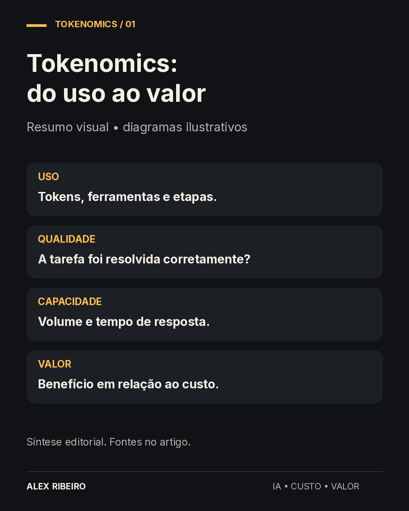

+++
title = 'Tokenomics em IA: o que é e por que importa'
description = 'Entenda como consumo, custo, qualidade e capacidade se relacionam ao valor de uma aplicação de IA.'
date = '2026-11-05T08:00:00-03:00'
lastmod = '2026-11-05T08:00:00-03:00'
slug = 'tokenomics-ia-conceito-importancia'
postId = 'e4535cbb6e188ef34caa8c19234046b1daeca162aa79f2539376f35b2d7521c4'
draft = false
categorias = ['Inteligência Artificial']
tags = ['ia', 'agentes', 'finops']
comments = true
+++

Uma empresa coloca um assistente de IA para responder dúvidas sobre seus produtos. O teste funciona, a resposta chega rápido e o custo de cada chamada parece pequeno. Quando o uso cresce, surgem outras perguntas: quanto custa uma conversa inteira? Quantas respostas precisam de correção? O serviço continua rápido quando chegam vários pedidos ao mesmo tempo?

Tokenomics ajuda a organizar essas perguntas. No contexto de IA, é o estudo da relação entre o uso dos modelos, os recursos consumidos e o valor obtido. A FinOps Foundation conecta essa disciplina à medição do consumo, à identificação de quem gerou o gasto e aos resultados para o negócio. [Fonte: FinOps Foundation](https://www.finops.org/insights/token-economics-the-atomic-unit-of-ai-value/).

O nome pode parecer distante, mas a preocupação é prática: entender o que uma aplicação de IA precisa consumir para entregar algo que realmente sirva ao usuário.

## O que é um token?

Para processar um texto, o modelo o divide em pequenas unidades chamadas tokens. Uma unidade pode representar uma palavra, parte dela ou um sinal de pontuação. Essa divisão depende do tokenizador usado pelo modelo. Por isso, contar palavras não basta para prever exatamente o consumo. A conhecida aproximação de quatro caracteres por token é uma referência para inglês, não uma regra para português. [Fonte: OpenAI](https://help.openai.com/en/articles/4936856-understanding-and-counting-tokens).

Em uma conversa, existem tokens de entrada, associados às informações enviadas, e de saída, associados ao que o modelo gera. A entrada pode incluir a pergunta, instruções, histórico e documentos. Assim, o que aparece na caixa de mensagem é apenas uma parte do material que a aplicação envia.

Aqui, token não é moeda digital nem participação em um ativo. É uma unidade utilizada no processamento de informação. Também não representa uma quantidade fixa de qualidade: produzir mais texto não garante uma resposta melhor.

## O que muda quando usamos agentes

Imagine pedir a uma aplicação que compare três propostas comerciais. Ela pode consultar documentos, buscar uma informação ausente, calcular valores e conferir a comparação antes de responder. Cada etapa pode exigir ferramentas e novas chamadas ao modelo.

Esse é um exemplo de trabalho conduzido por um agente. A Anthropic distingue agentes, que decidem dinamicamente como seguir e quais ferramentas utilizar, de fluxos em que as etapas foram predefinidas. Há compromissos de custo, tempo e previsibilidade nessa escolha. [Fonte: Anthropic](https://www.anthropic.com/research/building-effective-agents).

Para quem recebe a comparação, tudo parece uma única resposta. Para a aplicação, houve um percurso. Uma tarefa incompleta ainda pode ter consumido recursos, e uma tentativa adicional pode aumentar o gasto antes de produzir algo útil.

## Preço, consumo e valor respondem a perguntas diferentes

Uma tabela de preços informa quanto um fornecedor cobra por determinada unidade de uso. A medição mostra quantas unidades a aplicação consumiu. O resultado precisa ser avaliado: a tarefa foi resolvida corretamente, no prazo necessário e com o nível de confiança esperado?

Considere duas respostas a uma dúvida sobre um contrato. Uma é curta e custa pouco, mas omite a condição que muda a decisão. A outra exige mais processamento e inclui essa condição. Esse exemplo é hipotético; ele mostra por que economizar na chamada pode criar retrabalho depois.

Também pode acontecer o contrário: um modelo mais caro acrescenta custo sem melhorar uma tarefa simples. A comparação precisa acontecer no trabalho real que queremos resolver, com critérios definidos antes do teste.

Tokenomics oferece uma forma de ligar essas observações. O custo por token continua útil para explicar a fatura, enquanto a qualidade e o custo por tarefa ajudam a avaliar a solução.

## A capacidade também faz parte da conversa

Um serviço pode funcionar bem com poucos pedidos e formar uma fila quando o volume aumenta. Planejar IA envolve considerar demanda e capacidade, além da tarifa do modelo. O guia da NVIDIA organiza tokenomics em utilidade, demanda, oferta e monetização: o que o uso entrega, quanto será necessário, como atender esse volume e como sustentar economicamente a solução. [Fonte: NVIDIA](https://www.nvidia.com/pt-br/solutions/ai/tokenomics-guide/).

Para um processamento de documentos durante a noite, esperar alguns minutos pode ser aceitável. Para um atendente que precisa responder durante uma conversa, a mesma espera pode tornar a ferramenta pouco útil. O requisito depende do caso de uso.

## Por que olhar para isso desde o começo

Conhecer essa relação ajuda a decidir onde usar IA, qual qualidade exigir e quanto esforço vale dedicar à otimização. Também evita confundir volume de uso com benefício: muitas chamadas podem indicar adoção, mas podem indicar repetição ou dificuldade para concluir uma tarefa.

Uma primeira conversa sobre tokenomics pode começar com quatro perguntas:

- Qual problema a aplicação deve resolver?

- Como reconheceremos uma tarefa bem resolvida?

- Que recursos entram na conta para chegar até ela?

- O benefício justifica esse custo e o tempo de espera?

Essas perguntas aproximam quem desenvolve a aplicação de quem paga por ela e de quem a utiliza. A AWS relaciona essa gestão à visibilidade de gastos, otimização, governança e avaliação de valor; o retorno precisa considerar também serviços associados e trabalho de engenharia. [Fonte: AWS](https://aws.amazon.com/blogs/aws-cloud-financial-management/getting-started-with-tokenomics-on-aws/).

Tokenomics fica mais útil quando acompanha uma decisão concreta. Antes de perguntar apenas quanto custa gerar uma resposta, vale definir o que essa resposta precisa entregar. No próximo artigo da série, essa ideia vira uma comparação entre duas soluções e seu custo por tarefa concluída corretamente.

Parte 1 de 3. Fontes consultadas em 03/11/2026. Exemplos hipotéticos; nenhum resultado de cliente é apresentado.

